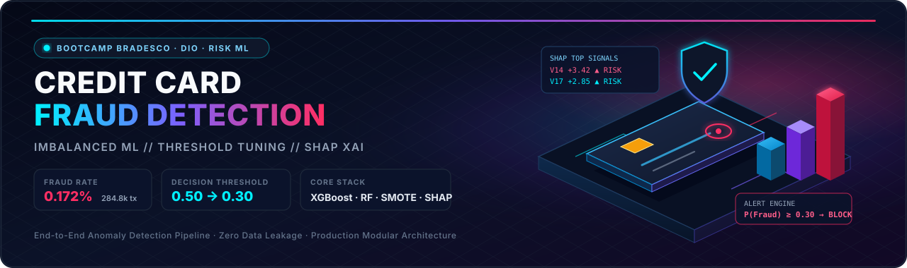
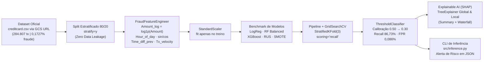
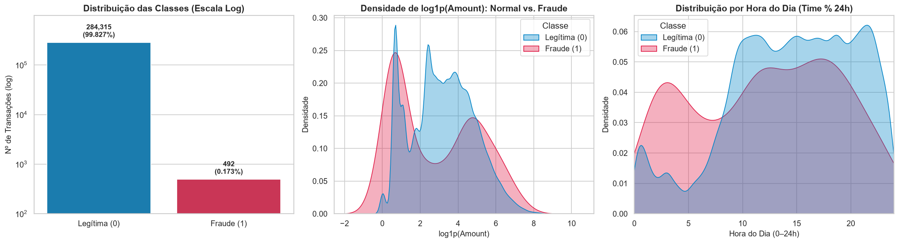
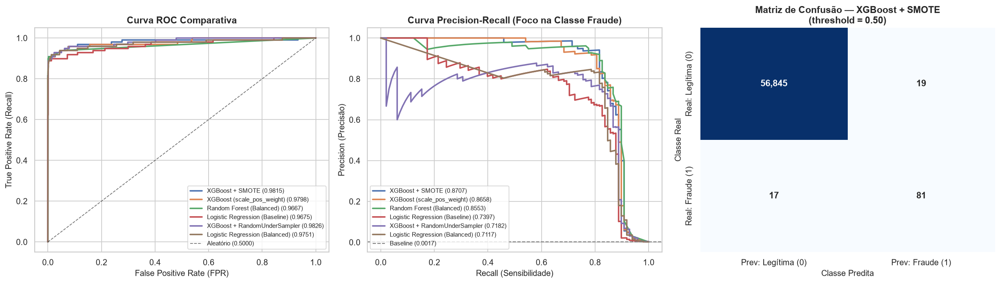
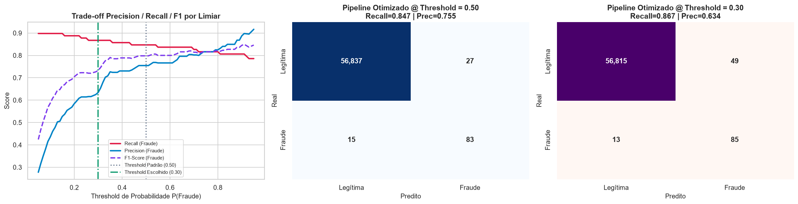
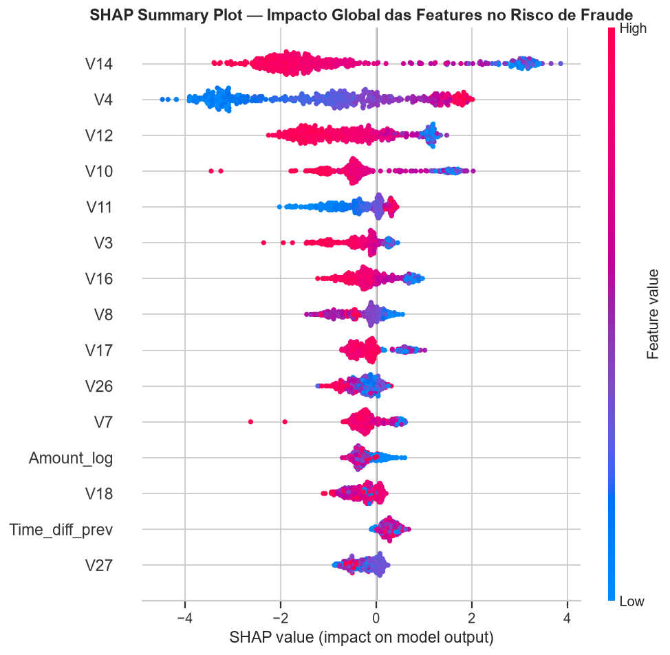
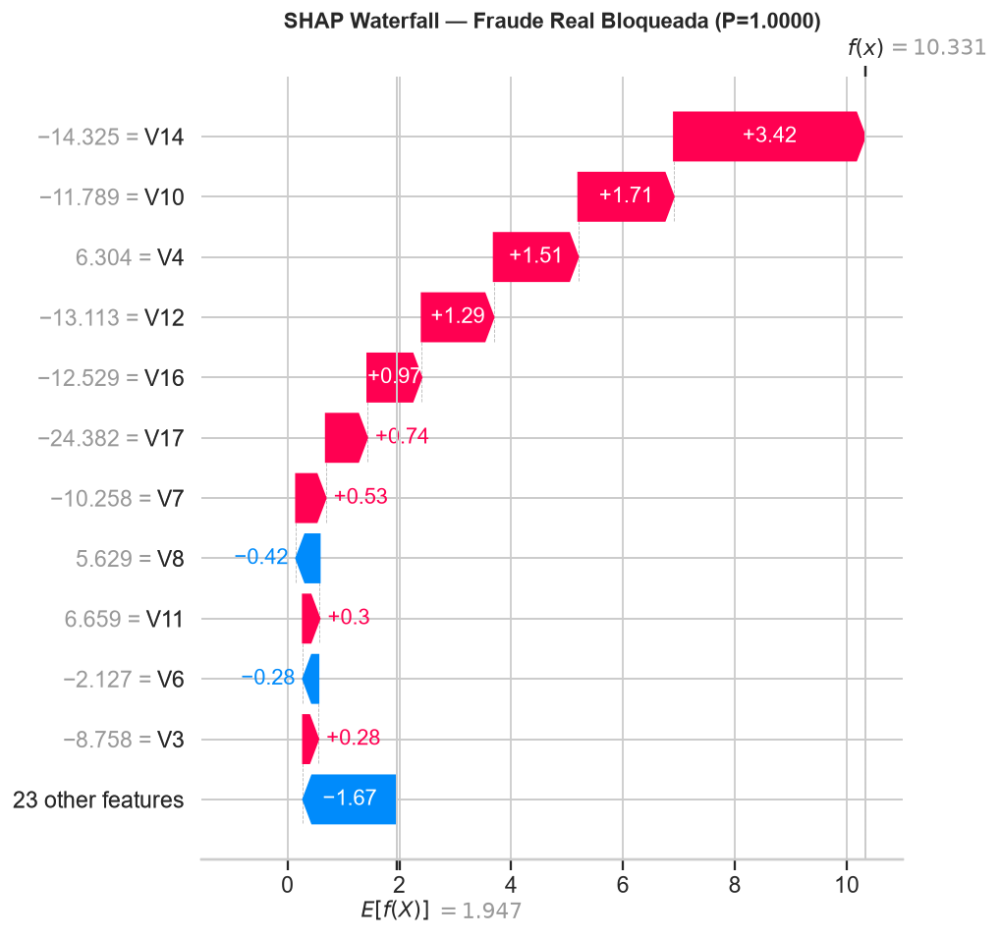
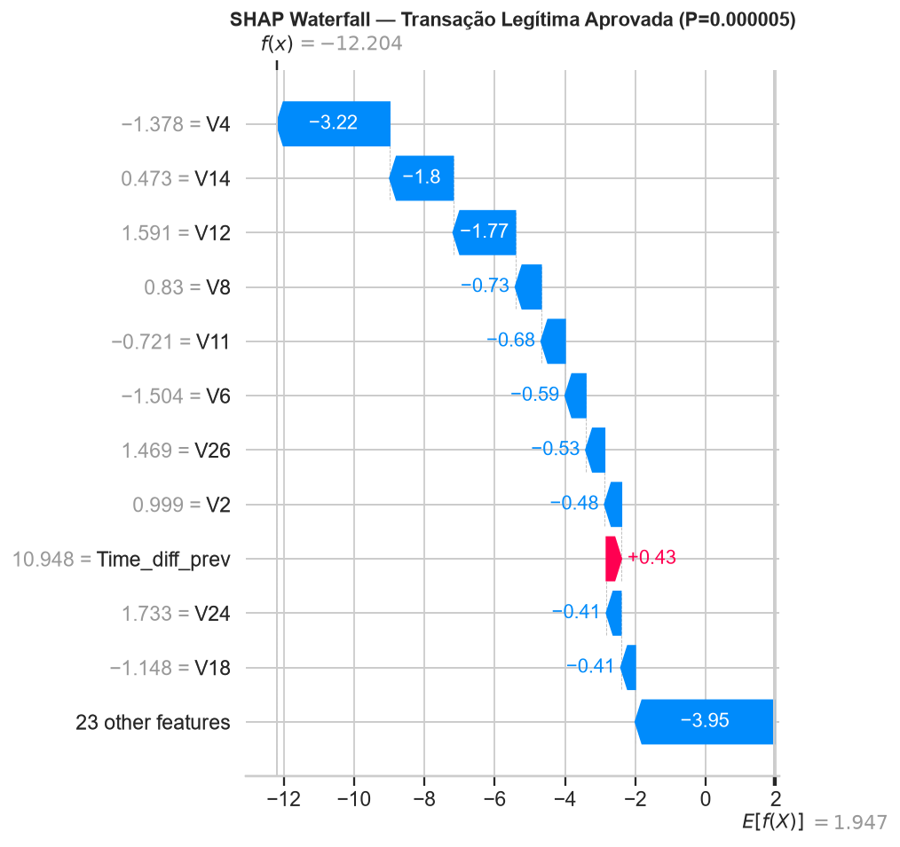

<p align="center">
  
</p>

<p align="center">
  <a href="notebooks/fraud_detection_pipeline.ipynb"></a>
  
  
  
  
</p>

# Detecção de Fraudes em Cartões de Crédito — Imbalanced ML, Threshold Tuning & SHAP (XAI)

Solução completa de nível sênior para o Desafio de Projeto **"Detecção de Anomalias em Transações em Python"** do **Bootcamp Bradesco — Agentes de IA do Zero à Prática (DIO)**.

O projeto implementa um pipeline ponta-a-ponta de detecção de fraudes financeiras sobre o benchmark oficial **ULB Credit Card Fraud Detection (`284.807` transações)** com prevenção rigorosa de *data leakage*, engenharia de features temporais causais, comparação empírica de estratégias de balanceamento (`class_weight`, `scale_pos_weight`, `RandomUnderSampler`, `SMOTE`), otimização com `GridSearchCV(scoring="recall")`, calibração de limiar de decisão (`0.50 → 0.30`), explicabilidade global e local via **SHAP** e arquitetura modular de produção (`src/` + `tests/`).

> **Notebook Principal Executado (com todas as tabelas, métricas e gráficos renderizados):**
> 👉 [**`notebooks/fraud_detection_pipeline.ipynb`**](notebooks/fraud_detection_pipeline.ipynb)

---

## Arquitetura End-to-End do Pipeline (ML + XAI + MLOps)



---

## Respostas Executivas aos 5 Tópicos Exigidos pela DIO

### 1. O Problema e o Paradoxo da Acurácia

No dataset **Credit Card Fraud Detection**, o desbalanceamento é extremo:

| Classe | Transações | Proporção |
| :--- | ---: | ---: |
| **Legítima (`Class = 0`)** | 284.315 | 99,8273% |
| **Fraude (`Class = 1`)** | **492** | **0,1727%** |
| **Total** | **284.807** | **100,0000%** |

- **Razão de desbalanceamento:** `577,88` transações legítimas para cada `1` fraude.
- **O Paradoxo da Acurácia (comprovado via `DummyClassifier`):** Um modelo trivial que classifica **100% das transações como legítimas (`0`)** atinge **99,8273% de acurácia**, mas entrega **0,00% de Recall** na classe minoritária — deixando passar todas as **492 fraudes** e gerando 100% de perda financeira (*chargeback*).
- **Métricas que governam a decisão em risco financeiro:**
  - **Recall (Sensibilidade na Classe 1):** Percentual de fraudes reais efetivamente bloqueadas (minimiza **Falsos Negativos**, que representam prejuízo financeiro direto).
  - **PR-AUC (Average Precision):** Métrica padrão-ouro em desbalanceamento severo; diferente da ROC-AUC (que pode parecer otimista acima de `0.97` mesmo com milhares de falsos positivos), a PR-AUC penaliza diretamente a degradação de precisão.
  - **Precision & FPR (Taxa de Alarme Falso):** Controlam o atrito com clientes legítimos e o custo operacional da mesa de prevenção a fraudes.

<p align="center">
  
</p>

---

### 2. Preparação dos Dados & Engenharia de Features

Todo o pré-processamento foi encapsulado no transformador customizado [`FraudFeatureEngineer`](src/features.py) e validado por testes unitários anti-vazamento:

1. **Carregamento Oficial sem Versionar Arquivos Grandes:** O notebook baixa diretamente `https://storage.googleapis.com/download.tensorflow.org/data/creditcard.csv` via `pd.read_csv(DATASET_URL)` (com cache local opcional em `data/creditcard.csv` estritamente bloqueado no `.gitignore`).
2. **Compressão Logarítmica (`Amount_log`):** Aplicação de `np.log1p(Amount)` para estabilizar a cauda pesada dos valores monetários (transações variam de `\$0,00` a `\$25.691,16`).
3. **Engenharia Comportamental Temporal (Evolução Extra):**
   - `Hour_of_day = (Time / 3600) % 24`, além das projeções cíclicas `Hour_sin` e `Hour_cos` (evitando descontinuidade entre 23h59 e 00h00).
   - `Time_diff_prev`: log-intervalo estritamente causal desde a transação imediatamente anterior.
   - `Tx_velocity_window`: taxa móvel causal de transações por minuto nos últimos 10 eventos anteriores, capturando rajadas típicas de ataques automatizados (*card testing*).
4. **Split Estratificado (`80/20`, `stratify=y`):**
   - **Treino:** `227.845` transações (`394` fraudes — `0,1729%`).
   - **Teste:** `56.962` transações (`98` fraudes — `0,1720%`).
5. **Prevenção Estrita de *Data Leakage*:** O `StandardScaler` e a mediana de fallback do `FraudFeatureEngineer` são ajustados **exclusivamente** no conjunto de treino (`fit_transform(X_train)`) e apenas aplicados ao teste (`transform(X_test)`), inclusive dentro de cada dobra do `GridSearchCV`.

---

### 3. Comparação dos Modelos (Resultados Reais no Conjunto de Teste)

Todos os 6 modelos abaixo foram avaliados exatamente sobre as mesmas **`56.962` transações de teste (`98` fraudes reais)** com corte padrão `threshold = 0.50`, ranqueados por **PR-AUC**:

| Ranking | Modelo / Estratégia | Recall (Fraude) | Precision (Fraude) | F1-Score (Fraude) | ROC-AUC | **PR-AUC** | TP | FP | FN |
| :---: | :--- | :---: | :---: | :---: | :---: | :---: | :---: | :---: | :---: |
| **1º** | **XGBoost + SMOTE (`sampling_strategy=0.10`)** | 82,65% | 81,00% | 0,8182 | 0,9815 | **0,8707** | 81 | 19 | 17 |
| **2º** | **XGBoost (`scale_pos_weight = 577.29`)** | **83,67%** | 78,85% | 0,8119 | 0,9798 | **0,8658** | 82 | 22 | 16 |
| **3º** | **Random Forest (`class_weight="balanced"`)** | 78,57% | **92,77%** | **0,8508** | 0,9667 | 0,8553 | 77 | **6** | 21 |
| **4º** | Logistic Regression (Baseline) | 66,33% | 80,25% | 0,7263 | 0,9675 | 0,7397 | 65 | 16 | 33 |
| **5º** | XGBoost + `RandomUnderSampler` (`0.10`) | 88,78% | 42,23% | 0,5724 | **0,9826** | 0,7182 | 87 | 119 | 11 |
| **6º** | Logistic Regression (`class_weight="balanced"`) | **91,84%** | 3,71% | 0,0713 | 0,9751 | 0,7117 | 90 | 2.338 | 8 |

#### Principais Achados Empíricos
- **Regressão Logística Baseline vs. Balanced:** O baseline perde **33 de 98 fraudes** (Recall `66,33%`). Adicionar `class_weight="balanced"` eleva o Recall para `91,84%`, mas destrói a precisão (`3,71%`, disparando **2.338 falsos alarmes** em um único lote de 56k transações).
- **Random Forest (`balanced`) vs. XGBoost (`scale_pos_weight`):** O Random Forest entrega a maior precisão pontual (`92,77%`, apenas 6 FP), mas deixa escapar 21 fraudes (`78,57%` Recall). Já o **XGBoost** supera o RF em **Recall (`83,67%`)**, **ROC-AUC (`0,9798`)** e **PR-AUC (`0,8658`)**, sendo ainda `3,5×` mais rápido no treino.
- **Undersampling vs. SMOTE:** O `RandomUnderSampler` descartou grande parte da classe majoritária, elevando o Recall para `88,78%`, mas fazendo os falsos positivos saltarem para **119** (Precision `42,23%`, PR-AUC `0,7182`). O **SMOTE** preservou toda a fronteira da classe majoritária e atingiu a **maior PR-AUC global (`0,8707`)** com apenas **19 FP** — comprovando superioridade sobre o undersampling agressivo neste domínio.

<p align="center">
  
</p>

---

### 4. Limiar de Decisão Escolhido (`0.30`) & Explicabilidade SHAP (XAI)

#### Otimização via `GridSearchCV(scoring="recall")` e Corte `0.50 → 0.30`
Encapsulamos `FraudFeatureEngineer → StandardScaler → XGBClassifier` em um `sklearn.pipeline.Pipeline` e executamos `GridSearchCV` com `StratifiedKFold(n_splits=3)` otimizando `scoring="recall"` (melhores hiperparâmetros: `max_depth=5`, `min_child_weight=1`, `n_estimators=180`; **ROC-AUC = `0,9786`**, **PR-AUC = `0,8601`**).

| Limiar (`threshold`) | Recall (Fraude) | Precision (Fraude) | F1-Score | Fraudes Bloqueadas (TP) | Fraudes Perdidas (FN) | Alarmes Falsos (FP) | Taxa de Alarme Falso (FPR) |
| :---: | :---: | :---: | :---: | :---: | :---: | :---: | :---: |
| **`0.50` (Padrão)** | 84,69% | 75,45% | 0,7981 | 83 / 98 | 15 | 27 | 0,0475% |
| **`0.30` (Escolhido)** | **86,73%** | 63,43% | 0,7328 | **85 / 98 (+2)** | **13 (-2)** | 49 (+22) | **0,0862%** |

- **Justificativa de Negócio para `threshold = 0.30`:** Reduzir o limiar de `0.50` para `0.30` capturou **+2 fraudes reais adicionais** (reduzindo as perdas em **13,3%**, de 15 para 13 FN), ao custo operacional de apenas **+22 alertas extras** (FPR global ainda inferior a **0,09%** sobre `56.864` transações legítimas) — perfeitamente absorvíveis por autenticação *step-up* (biometria/SMS/app push) sem prejudicar a experiência do portador.

<p align="center">
  
</p>

#### Explicabilidade Global e Local com SHAP (`TreeExplainer`)
A análise SHAP sobre a amostra estratificada do teste (todas as `98` fraudes reais + `402` transações legítimas) revelou os principais direcionadores de risco:

| Posição | Feature | Mean `\|SHAP\|` | Interpretação de Risco |
| :---: | :--- | :---: | :--- |
| 1 | **`V14`** | `1.8801` | Principal marcador de fraude: valores fortemente negativos impulsionam drasticamente o log-odds de fraude. |
| 2 | **`V4`** | `1.6533` | Valores altos positivos elevam consistentemente a probabilidade de anomalia. |
| 3 | **`V12`** | `0.9175` | Quedas acentuadas em `V12` atuam como forte sinal combinado com `V14` e `V10`. |
| 4 | **`V10`** | `0.7593` | Desvios negativos profundos aumentam o risco de bloqueio. |
| 5 | **`V11`** | `0.4586` | Valores elevados reforçam o padrão fraudulento. |
| 6–10 | `V3`, `V16`, `V8`, **`V17`**, `V26` | `0.31 – 0.39` | Complementam a assinatura multivariada de fraude (junto com **`Amount_log`** e **`Time_diff_prev`** no Top 14 global). |

<p align="center">
  
</p>

Na explicabilidade local (`shap.waterfall_plot`), cada bloqueio é totalmente auditável para *compliance* e atendimento — como na fraude real bloqueada (`P = 1.0000`), onde `V14 = -14.325` (`+3.42`), `V10 = -11.789` (`+1.71`), `V4 = 6.304` (`+1.51`), `V12 = -13.113` (`+1.29`) e `V17 = -24.382` (`+0.74`) elevaram o score de `E[f(X)] = 1.947` para `f(x) = 10.331`:

<p align="center">
  
  
</p>

---

### 5. Evoluções Implementadas Além da Aula da Expert

| Evolução | Descrição Técnica | Artefato |
| :--- | :--- | :--- |
| **Engenharia Temporal Causal** | Criação de `Hour_of_day`, projeções cíclicas (`Hour_sin`, `Hour_cos`), `Time_diff_prev` e `Tx_velocity_window` sem vazamento de futuro, com `Time_diff_prev` figurando no Top 14 global do SHAP. | [`src/features.py`](src/features.py) |
| **Benchmark `Undersampling vs SMOTE`** | Comparação controlada via `imblearn.pipeline.Pipeline` provando que `XGBoost + SMOTE` maximiza a `PR-AUC` (`0.8707`) enquanto `RandomUnderSampler` degrada a precisão (`42.23%`). | [`notebooks/fraud_detection_pipeline.ipynb`](notebooks/fraud_detection_pipeline.ipynb) |
| **`GridSearchCV` Focado em Recall** | Otimização sistemática de hiperparâmetros com `StratifiedKFold(3)` dentro de um `Pipeline` completo (`zero leakage`), mantendo `PR-AUC = 0.8601`. | [`notebooks/fraud_detection_pipeline.ipynb`](notebooks/fraud_detection_pipeline.ipynb) |
| **Camada Modular de Produção (`src/`)** | Transformador `FraudFeatureEngineer`, classificador calibrável `ThresholdClassifier` com faixas de risco (`LOW`, `MEDIUM`, `HIGH`, `CRITICAL`) e CLI JSON de inferência em tempo real. | [`src/`](src/) |
| **Testes Automatizados (`-W error`)** | Suíte `unittest` validando `np.log1p`, features temporais, prevenção de data leakage no `StandardScaler`, corte `0.30` e serialização `joblib` (6/6 passando com zero warnings). | [`tests/test_fraud_pipeline.py`](tests/test_fraud_pipeline.py) |

---

## Estrutura do Repositório

```text
credit-card-fraud-detection-ml/
├── assets/
│   └── banner.svg                          # Banner vetorial isométrico 3D cyber-dark
├── notebooks/
│   └── fraud_detection_pipeline.ipynb      # Notebook completo e executado (6 Passos + XAI)
├── reports/
│   ├── figures/                            # Gráficos exportados de EDA, ROC/PR, Threshold e SHAP
│   └── metrics_summary.json                # Resumo auditável de todas as métricas reais
├── src/
│   ├── __init__.py
│   ├── features.py                         # FraudFeatureEngineer (log1p + features temporais causais)
│   ├── threshold.py                        # ThresholdClassifier (corte configurável 0.30 + faixas de risco)
│   └── inference.py                        # CLI de inferência JSON em tempo real
├── tests/
│   └── test_fraud_pipeline.py              # Testes unitários (unittest, -W error)
├── .gitignore                              # Bloqueia *.csv, data/, *.joblib, .venv/, checkpoints
├── requirements.txt                        # Dependências reprodutíveis
├── LICENSE                                 # Licença MIT
└── README.md
```

---

## Como Executar Localmente

### 1. Configurar Ambiente Virtual & Dependências
```bash
git clone https://github.com/lcszero44-cell/credit-card-fraud-detection-ml.git
cd credit-card-fraud-detection-ml
python -m venv .venv

# Windows (PowerShell)
.\.venv\Scripts\Activate.ps1
# Linux / macOS
# source .venv/bin/activate

pip install -r requirements.txt
```

### 2. Executar o Notebook Completo (Download Automático da URL Oficial)
```bash
jupyter nbconvert --to notebook --execute --inplace notebooks/fraud_detection_pipeline.ipynb
```
> **Nota de Boas Práticas GitHub:** O arquivo `creditcard.csv` (~150 MB) **nunca** é commitado no repositório. O notebook baixa os dados diretamente de `https://storage.googleapis.com/download.tensorflow.org/data/creditcard.csv` e mantém cache local opcional em `data/creditcard.csv` (ignorado no `.gitignore`).

### 3. Executar a Suíte de Testes Unitários (Zero Warnings)
```bash
python -W error -m unittest discover -s tests -v
```

### 4. Avaliar Transações via CLI de Inferência em Tempo Real
```bash
# Modo demonstração (usa models/fraud_pipeline.joblib se gerado pelo notebook, ou modelo demo)
python -m src.inference --demo

# Avaliando uma transação JSON customizada com limiar 0.30
python -m src.inference --threshold 0.30 --json '{"Time": 7250.0, "Amount": 489.00, "V14": -8.2, "V17": -7.4, "V12": -6.3, "V10": -5.8}'
```

---

## Licença

Distribuído sob a licença **MIT**. Consulte [`LICENSE`](LICENSE) para mais detalhes.
